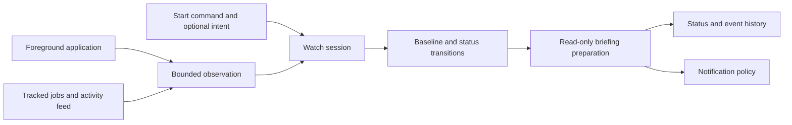

# Watch Mode: useful attention while the computer works

Feature draft and implementation record, 13 October 2026. The implementation
status at the end distinguishes the usable foundation from the full experience.

## The experience

“Jarvis, watch the computer” starts an ongoing session. Jarvis establishes what
is happening, follows relevant changes, and prepares a useful explanation when
something finishes or needs attention. The user can continue using the computer.

Example: a test run is already running when Watch Mode starts. Jarvis records
that run as in progress. When its tracked status changes to failed, he prepares
a short briefing with the failure evidence and a suggested next step. Ordinary
progress updates stay quiet. “What happened?” retrieves the briefing; “stop
watching” ends observation.

Example: a download appears in the existing activity feed. Jarvis follows its
identity and status, rather than treating every filename or percentage change
as a new task. A completion becomes one event. A disappeared download without
completion evidence remains uncertain, rather than being announced as success.

Example: the foreground window changes to a document editor. Jarvis can say
which application is active. Its title alone does not establish the document's
contents or what the user wants him to write. Deeper interpretation needs a
bounded screen observation or an explicit target supplied by the user.

## Existing behavior and naming

The repository already contains `src/watch_mode.py`. That security feature guards an
unattended laptop using webcam motion recording, a fullscreen overlay and guest
restrictions. `src/bridge.py` and `src/system/watch_tools.py` previously routed
“watch the computer” into that security feature.

Productive Watch Mode needs an independent lifecycle and state. The phrase
“watch the computer” should select useful computer observation. Fullscreen guard activation is unavailable through assistant and bridge routes
until its desktop exit controls are repaired. Leaving statements do not start watch. Entering
productive observation must not implicitly place the user into guest mode.
Guest restrictions continue to gate owner-only tools regardless of this feature.

## Functional contract

1. **Understand the situation.** Establish a baseline of the active application,
   tracked jobs and activity items. Use the current request or a bounded recent
   conversation summary as intent evidence when available. Distinguish observed
   facts, inferred intent and unavailable information.
2. **Observe meaningful changes.** Track stable task identities and status
   transitions. Completion, failure and requests for input deserve an event;
   routine progress and foreground changes do not automatically deserve speech.
3. **Prepare background help.** Produce a concise explanation and a next step
   from the available evidence. Preparation must be bounded and read-only.
   Actions that modify files, interact with an application, retry work or send
   something require a separate authorized request.

## Lifecycle

`stopped → establishing baseline → watching → stopped`

Starting an already active session is idempotent. It must not duplicate workers
or reset evidence needed to detect a running task's eventual completion.
Stopping is also idempotent and preserves the last briefing for inspection.
Only an explicit start command activates productive monitoring.

Unavailable sensors produce an honest degraded status. A task remains unknown
when evidence is missing; polling errors never become task failures. Observation
should resume with fresh evidence without announcing every recovered sensor as
user work. Session generation or equivalent locking must prevent an old worker
from publishing after stop/restart.

Control operations must stay responsive while sensors run. Blocking desktop
queries belong off the voice event loop. One observation or preparation may run
at a time; pending work must be bounded. A process restart must not silently claim
that an old session was continuously observed.

## Evidence and data flow

The repository supplies `active_window.active()`, `jobs.recent()` and
`activity.list_items()` as available inputs. Existing build and
window monitor registries have stronger task evidence for explicitly tracked
work and can be integrated without inventing completion from screen appearance.
The proactive engine already has quiet/focus decisions, speech caps and delivery
deduplication; future spoken events should share that policy rather than create
another independent interruption loop.

An observation should carry source availability and timestamps. A task event
should carry task identity, previous and current status, evidence, time, severity
and any prepared next step. Summaries should remain short and grounded in those
fields. Baseline items already complete when monitoring starts are historical
context; they should not be reported as newly completed work.

Conversation is intent evidence, not permission to perform unrelated work.
Screen content, output and window titles are untrusted data. A webpage instruction
to run a command must never become a background action.

## Cost and interruption controls

Use cheap local observations first. Poll on a modest fixed interval with bounded
input sizes, event history and failure backoff. Compare evidence before invoking
an optional model. No meaningful evidence change means no inference call.

Deduplicate by task identity and transition, not wording. Preserve a completion
once even if its source emits it repeatedly. Support a new run of the same task
without suppressing its legitimate completion. Avoid calling a task stalled
solely because the screen is static: thresholds need task-specific progress
evidence and an explicit uncertainty label.

For the full experience, prioritize errors and input requests; batch routine
completions. Speak only through the normal delivery policy. Keep status available
even when speech is deferred or disabled. Draft help belongs in the session
briefing so the user can inspect it before requesting any corrective action.

## Acceptance scenarios

- Starting observation establishes a baseline and keeps the desktop usable.
- A tracked running task transitioning to success produces one completion event.
- A tracked running task transitioning to failure produces evidence and a useful
  prepared next step without executing that step.
- Repeated identical observations do not repeat the event or trigger new work.
- An item complete before the baseline is not announced as a fresh completion.
- A missing source degrades observation and does not invent success or failure.
- Stop/restart prevents an old poll from writing into the new session.
- Status and summary clearly expose what Jarvis is watching and what changed.
- Assistant and bridge guard actions refuse activation. Guest restrictions
  still prevent productive owner actions while the standalone guard is active.
- Tests use injected observations and clocks; they do not need a live desktop,
  camera, model account or network.

## Historical metadata foundation

Before the visual extension below, the repository implemented this first stage:

- `src/computer_watch.py` owns a thread-backed, read-only observation session in
  the bridge process. It observes foreground-window metadata and the existing
  activity feed; it captures no pixels or OCR.
- `src/computer_watch_client.py` uses the configured authenticated local bridge
  transport. Voice controls and bridge fast routes share that single session.
  Bridge outages return an error and do not start a second observer.
- “Watch the computer/laptop” and “start watch mode” start productive watching;
  “stop watching” / “stop watch mode”, “watch mode status”, and “what happened
  while watching” control and inspect it. Guard and sentry requests cannot start
  the fullscreen security feature through assistant or bridge routes.
- Recent owner user requests are bounded to 3,000 characters in memory. Private
  phone and guest sessions are refused; sensitive screen readback context is
  excluded. These are user requests, not a copy of the full conversation.
- The configured Gemini text model receives bounded window/activity evidence
  and recent owner requests, with no action tools. Start acknowledgments disclose
  that model analysis. It prepares task explanations and suggested next steps.
  Output never executes a suggested fix.
- Authoritative activity transitions from running to done/failed establish
  completion/error events. The model cannot establish success from a title,
  missing process or static screen. Already-complete baseline items stay quiet.
- The default poll interval is 30 seconds, rising to at most 300 seconds on
  repeated failures. Identical evidence is skipped; history keeps 30 events and
  100 transition keys. Model calls have a 20-second network timeout with retries
  disabled. Analysis failure keeps authoritative activity monitoring available.
- Completion and failure produce neutral local notifications with speech and
  queued speech disabled. Briefings expose evidence and prepared suggestions on
  request. Stop/restart uses generations to discard late results. Guest/privacy
  authority loss revokes retained evidence; voice-session shutdown stops watching.

Verification includes isolated core behavior, adversarial evidence, productive
and refused sentry command routing, guest restrictions and authenticated HTTP tests that
start through a fast route and stop/read status through the voice tools. Tests
use fake observations and models; no real desktop or model account is exercised.

At that stage, the full visual experience remained future work. Arbitrary application contents,
installer dialogs requiring input, task-specific stall detection, deeper build
log diagnosis and assistant-turn conversation extraction were not implemented.
Task descriptions and prepared help depend on the configured model being
available; authoritative activity transitions still work when it is unavailable.
The activity feed must already track a task for this stage to know its outcome.
Window titles alone cannot establish contents or completion.

The agreed next stage was to extend the existing foreground screen backend with an
explicit owner Watch Mode grant: selected-window scope, expiring/revocable
session, generation checks before capture and provider upload, existing provider
consent, sensitive output/context hooks, no retained raw images/OCR, and no full
screen fallback. That grant must come from trusted application ingress rather
than a model tool argument. Visual observation should be requested only when
local evidence changes and should remain bounded by a session inference budget.

## Desktop lockout restriction

The fullscreen webcam security guard cannot be started through assistant tools,
voice routing, or the bridge legacy `watch_mode` action. Its exit controls have
caused desktop lockouts and require repair before those activation paths return.
Productive computer observation remains separate. The standalone guard source is
preserved; development and verification must not launch it, capture the webcam,
or lock the desktop. Guard unit tests must inject fake process and lock runners.

## Current visual implementation, 13 October 2026

The visual implementation uses the existing selected-window capture backend and
adds a separate Watch Mode capability. `ScreenService` remains a one-request
local OCR service; its version-one host consent authorizes local OCR, not Gemini
image uploads. A visual watch grant must explicitly disclose the configured
Gemini provider, image processing, selected-window scope, expiry and call budget.
It is loaded from an explicitly configured private owner file and consumed by a
fresh trusted owner start request. Model-generated tool arguments, recent
conversation, window text and native Resume cannot mint or extend that grant.

The implemented interactive path also provisions that session grant directly:
an actual owner "watch the computer" request displays/speaks the disclosure and
pins the disclosed window id, application and process. With the dedicated native
helper configured, existing active-window metadata is only a candidate hint:
fresh native `getWindowInfo` must verify that UUID/process and supply the actual
window caption for a named-target disclosure. A fresh "confirm visual
watch" within two minutes, from the same voice or native control session, grants
the disclosed provider and limits. Confirmation is consumed once and verifies
that target again during backend enrollment. An application-only generation
callback revokes consent if Stop arrives during enrollment. No JSON file editing
is necessary for this path.
The exact confirmation phrase is displayed in trusted owner controls but never
recited in the spoken disclosure, including when a target caption contains it.
Spoken disclosure is registered with the existing echo guard. A purported
confirmation during assistant speech or classified as speaker echo is consumed
without granting capture; fresh human confirmation and the physical tray
confirmation control remain available. Microphone controls stay usable.

For the current Linux KDE implementation, select the application window to
observe and say "watch the computer". Review the Gemini screenshot disclosure,
then say "confirm visual watch" within two minutes for that named window. The
tray offers the same disclosure and confirmation controls, plus
"Stop Watch Mode", "Watch Mode status" and "Watch Mode briefing — private
window". "Stop watching" also ends the session. The foreground backend pauses
when focus changes. The separately disclosed native **pinned-window** policy
keeps observing the named window while the user switches applications; minimized
or closed targets pause capture. Neither policy expands to another application.
A foreground-only grant cannot be reused for pinned observation.

The shared bridge owns the worker. Voice controls, authenticated bridge controls
and the desktop Stop control operate that same worker; clients never launch a
second observer. A grant captures the initial selected window identity, not the
whole desktop. Before and after each native capture, direct `getWindowInfo` must
match the pinned UUID, process and application and validate current geometry,
minimized/excluded state. `CaptureWindow(UUID)` isolates that compositor surface
from unrelated windows, rather than capturing whatever is currently focused.
Safe resizes use verified current geometry. Missing geometry or capture failure
pauses observation and reports the reason. The foreground backend separately
checks focus/occlusion. There is no desktop fallback or automatic retargeting;
a fresh trusted start selects a new target.

The native package uses a dedicated executable/desktop identity
`dev.jarvis.watchcapture`, with only `org.kde.KWin.ScreenShot2` entitlement on
that helper. Python and the shell receive no screenshot grant. The owner-local
installer, exact configuration path, review steps and hash-checked removal are
documented in [native/window-capture/PACKAGING.md](../native/window-capture/PACKAGING.md).
On the next owner-process startup, the default package is discovered only after
its private manifest identity, binary hash and exact desktop entry are verified.
An explicit absolute-path override remains optional for reviewed deployments.
Installation never edits environment/service files or restarts running Jarvis.
The package is staged in source; installation and live capture follow review
of the concrete native helper. No Spectacle identity or global permission is
used.

The worker samples selected-window pixels on the bounded observation interval,
because application contents can change while window metadata stays identical.
A changed frame hash, relevant activity transition or changed owner task context
can justify inference. One capture/inference runs at a time. An unchanged frame
does not incur another provider call. Default limits are a thirty-second minimum
interval, twenty-second model timeout, sixty image calls and a two-hour maximum
grant lifetime. Status exposes remaining budget, provider, expiry, target and
visual degradation separately from metadata observation. Budget exhaustion
stops further uploads; session expiry ends visual watching and clears its private
derived evidence. A fresh owner request is required to renew permission.

Capture, OCR and inference check session generation and owner authority before
device access, before provider submission and after inference. Stop revokes the
capability immediately, including a capture or inference already in progress.
Late results cannot restore state or emit notifications. Captured bytes and raw
OCR are transient operation inputs, cleared on every success, failure and stop;
neither enters logs, event history, normal voice context or persisted captions.
Only bounded derived observations, hashes and event evidence remain in memory.
Authority loss clears that derived evidence as well.
Private operation-scoped capture/OCR temporary directories use memory-backed
`/dev/shm`; files are removed on completion or cancellation. Raw inputs are not
written to persistent temporary storage.

Visual model output is untrusted structured evidence. It can identify a task,
visible progress, a dialog needing input, an error or an explicit completion
message. Every meaningful visual event needs a concrete supporting quote or
visible description, calibrated confidence and a source label. Completion needs
an observed running baseline for that task; an already-finished baseline stays
quiet. Disappearance, a title change and a static frame cannot establish success.
Possible stall requires an identified running task and repeated observed lack
of task progress over a bounded threshold, and remains explicitly uncertain.
Authoritative tracked activity transitions retain priority over visual inference.

Prepared help explains the observed problem and suggests a next step without
executing commands, editing files, clicking controls or sending messages. Public
notifications say only that watched work needs attention or finished; sensitive
task details remain in the owner-requested briefing. Normal quiet/focus delivery
policy controls interruptions. Watch status and Stop remain available when
notification delivery or inference is unavailable.
The native tray exposes disclosure, confirmation, Stop, status and briefing.
Briefing opens an ordinary dismissible `kdialog` window after an owner click;
its derived explanation does not enter a desktop notification. Voice requests
for visual briefing direct to that window, preserving microphone availability.
Model-facing status and briefing responses omit private visual task/event text.
Derived briefings remain readable through authenticated actual-user controls.
Stop bypasses queued client work, cancels pending start/confirmation requests,
and advances a server-checked per-client transport epoch. The core generation
also prevents enrollment results from starting a worker after Stop.

### Implementation ownership and acceptance gates

- The visual module owns host grant validation, selected-window capture, hashing,
  transient OCR, bounded configured Gemini image inference and source evidence.
- The session core owns start/stop generations, shared worker, visual task
  baseline, event deduplication, preparation, budgets and degraded status.
- Bridge, voice and desktop adapters own trusted request correlation, provider
  disclosure, inspectable status and a responsive Stop control.
- Hermetic tests cover consent expiry/replay, provider refusal, focus change,
  occlusion, cancellation at every boundary, unchanged frames, budget exhaustion,
  historical completion, input requests, uncertain stalls and malformed model
  output. No test imports a live guard runner.
- Desktop verification starts only after the user's 17:40 Singapore availability
  on 13 October 2026. It exercises a harmless selected test window, responsive
  Stop and ordinary desktop use. It never starts the fullscreen security guard,
  locks the OS, captures the webcam or kills guard processes.

The visual service, core lifecycle, trusted owner command handshake, bridge and
voice adapters, and native tray controls are implemented in source. Focused
integration tests cover disclosure/confirmation, exact command consumption,
owner loss, target binding, queued operation cancellation, stop during target
selection and per-client epoch rejection. Native tray compilation passes with
the existing dead-code warnings. The private briefing requires installed
`kdialog`, available on this machine. No full assistant or tray runtime has been
launched/restarted as part of these source checks. Desktop capture verification
is performed separately after the authorized time; final provider/live results
must be recorded separately from the hermetic integration checks.

### Live verification results — 13 October 2026

Live checks began only after the user's 17:40 Singapore access window. The
original foreground-probe route could not obtain an authenticated callback from
KWin 6.7.3; callback-only tests also timed out. The actual compositor service was
verified as native `kwin_wayland`, PID 3073, on the correct Wayland/Xwayland
session. That legacy limitation remains visible and was not bypassed.

The new dedicated native **pinned-window** renderer passed an actual desktop
capture/OCR test on an ordinary owned 640×300 synthetic window. Read-only
WindowsRunner `Match` of its unique synthetic title identified the candidate;
fresh native `getWindowInfo` verified its UUID, application and the test process's
own PID before enrollment. Only this target was captured. All three observed
phases matched the controlled window text: **running → input needed → completed**.
This used real KWin `CaptureWindow` and local Tesseract OCR, with an injected
local inference stub. It establishes native capture and OCR readiness, while
keeping provider inference verification separate.

The reviewed managed helper is installed at
`/home/ripjk/.local/libexec/jarvis-watch-capture`, with its legitimate dedicated
`/home/ripjk/.local/share/applications/dev.jarvis.watchcapture.desktop` entry.
Its ELF SHA-256 is
`7021e853d74dfbf2917bb0de883dd29b1b2991f1d8fd297a99d83649b34cba1c`.
The installed package manifest and executable/desktop hashes validated after
installation. Only `kbuildsycoca6` was refreshed. No compositor, Jarvis or guard
restart was needed. Native grants require fresh pinned-window disclosure; an
old foreground-only grant cannot enable this background-capable renderer.

Configured inference checks made three generation requests using the existing
configured Gemini model. Two used generated synthetic PNG/OCR fixtures: the first reached
its twenty-second deadline with `ReadTimeout`; the second, using a test-only
forty-five-second deadline, returned HTTP 503 `ServerError`. A final request used
only the freshly owned native synthetic window and ended with a sanitized
`ScreenError`: “Visual observation unavailable; no screen conclusion.” No
provider or model fallback was attempted. An unauthenticated HTTPS check reached
the provider in approximately 0.04 seconds, so these results do not establish a
connectivity outage or an unsupported model. A final read-only model metadata
request, bounded to five seconds with no retries, returned
`models/gemini-3.8-flash` and listed `generateContent` support. The configured
model therefore exists and supports generation; this does not establish successful
image inference. Successful configured-model visual inference remains unverified;
failure is exposed without a fabricated screen conclusion. Production requests retain a twenty-second deadline, one attempt,
no tools and explicitly disabled automatic function calling.

The expanded checks passed **405 tests in total, with 3 intentional skips**;
that total includes **8 Rust helper tests** covering real kernel memfd seals
and shared-offset partial-write checks. Offline release build and Clippy with
warnings denied passed. Ruff passed for the changed Python modules and smoke
harnesses. These checks cover grant distinction, target binding, budgets,
cancellation, metadata validation and safe provider failure handling.

Both ordinary owned test windows closed, and owned scripts, connections,
staging files and temporary directories were cleaned up. Post-test checks found
zero remaining `jarvis-screen-*` or OCR temporary directories in `/dev/shm`.
Pixels used anonymous bounded memfd/operation-scoped memory storage; no
persistent screenshot artifact was created. The managed helper remains installed
for the requested feature. No watcher was enabled on user windows. No fullscreen
guard, OS lock, webcam, full Jarvis runtime or existing service was launched,
restarted or killed during these checks.
